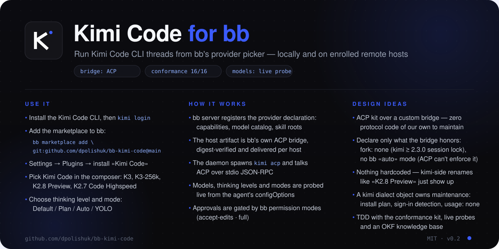

<p align="center">
  
</p>

<h1 align="center">bb-kimi-code</h1>

<p align="center">
  Run <a href="https://github.com/MoonshotAI/kimi-code">Kimi Code CLI</a> inside
  <a href="https://github.com/get-bb/bb">bb</a> — on your machine and on remote hosts.
</p>

<p align="center">
  <a href="LICENSE"></a>
  
  
  
</p>

---

**bb-kimi-code** is a bb provider plugin: it registers Kimi Code as an agent
provider in bb's provider picker and runs its threads through Kimi Code's ACP
server (`kimi acp`). Because bb delivers the bridge to every enrolled host as
a content-addressed artifact, the same plugin drives Kimi Code on **remote
machines** — the only requirement on a host is an installed and signed-in
`kimi` CLI.

## Features

Everything Kimi Code exposes over ACP works in bb:

- **Threads with streaming and resume** — the canonical bridge conformance
  suite passes live against a real `kimi acp`, except `session/fork-identity`:
  kimi ≥ 2.3.0 locks live sessions to their process and bb forks from a new
  process, so fork is disabled (`fork: "none"`).
- **Tool calls on the timeline** — file edits, commands, searches and reads
  render as native bb rows (live-verified with a real file-writing turn).
- **Model picker** — the models Kimi Code reports (`kimi-code/k3`,
  `kimi-code/k3-256k`, K2.8 Preview, K2.7 Code Highspeed, and more).
- **Thinking levels** — Low / High / Max map onto Kimi Code's `thinking`
  session option.
- **Modes and `/plan`** — Default / Plan / Auto / YOLO in the composer footer,
  straight from Kimi Code's `mode` session option; bb's `/plan` composer action
  enters Kimi Code's read-only plan mode before the turn.
- **Slash commands** — `/compact`, `/status`, `/usage`, your skill commands:
  published into bb's composer menu from the live session.
- **Approvals** — gated by bb permission modes (`accept-edits`, `full`);
  Kimi Code's AskUserQuestion arrives as an approval with options.
- **Subagents and swarms** — `Agent` calls appear as delegation rows;
  `AgentSwarm` appears as a workflow with one entry per swarm item.
- **Image input** — local images are sent as ACP image blocks.
- **Skills** — `.kimi-code/skills` and `.agents/skills` are discovered for
  user and project roots.
- **Maintenance** — sign-in detection (`kimi login` hints), and installing
  Kimi Code from bb on a host where it is missing.

Known limits (protocol- or product-level, not plugin bugs): no video input
(ACP has no video content block), no account quota display (Kimi Code exposes
no usage API), and MCP servers are configured by Kimi Code itself.

## Requirements

- [bb](https://github.com/get-bb/bb) >= 0.46 (desktop app or `npx bb-app@latest`)
- [Kimi Code CLI](https://github.com/MoonshotAI/kimi-code) on every host you
  want to run it on — or let bb install it for you from the provider card
- Sign in on each host: `kimi login`

## Install

From the marketplace:

```
bb marketplace add git:github.com/dpolishuk/bb-kimi-code@main
```

then install **Kimi Code** from the `kimi-code` catalog in
Settings → Plugins → Marketplace. Details and release flow:
[docs/marketplace.md](docs/marketplace.md).

Or directly:

```
git clone https://github.com/dpolishuk/bb-kimi-code.git
bb plugin install ./bb-kimi-code
```

Then pick **Kimi Code** in bb's provider picker and start a thread.

## How it works

The plugin is deliberately thin. The server entry registers the provider
declaration; the host entry re-exports bb's published ACP bridge
(`@get-bb/plugin-sdk/provider-bridge/acp-next`) and registers a small `kimi`
dialect carrying maintenance facts (install script, sign-in detection). bb
builds the host artifact, ships it to the target host's daemon
content-addressed, and the bridge drives `kimi acp` over stdio — locally or
remotely, through the same code path.

```
bb server --> host daemon (any enrolled machine) --> kimi acp --> Kimi models
```

## Documentation

- [Architecture overview](docs/architecture.md) — components, request flow,
  remote hosts, trust model, testing layers.
- [Setup guide](docs/setup.md) — step by step: install bb, Kimi Code, the
  plugin; first thread; remote hosts; troubleshooting.

## Development

```
npm install
npm test            # unit + contract tests
npm run typecheck
npm run build       # bb plugin build
```

Live integration tests run against a real, signed-in `kimi` CLI and are
gated off by default (the conformance suite spends a few model tokens):

```
BB_KIMI_LIVE=1 npx vitest run kimi-live.conformance.test.ts \
  kimi-live.session-state.test.ts kimi-live.maintenance.test.ts \
  kimi-live.tools.test.ts
```

The repo carries an engineering knowledge base in [OKF v0.2](knowledge/index.md)
(`knowledge/`) — architecture, contracts, and the decisions behind them.

## License

[MIT](LICENSE) (c) Dmitry Polishuk
